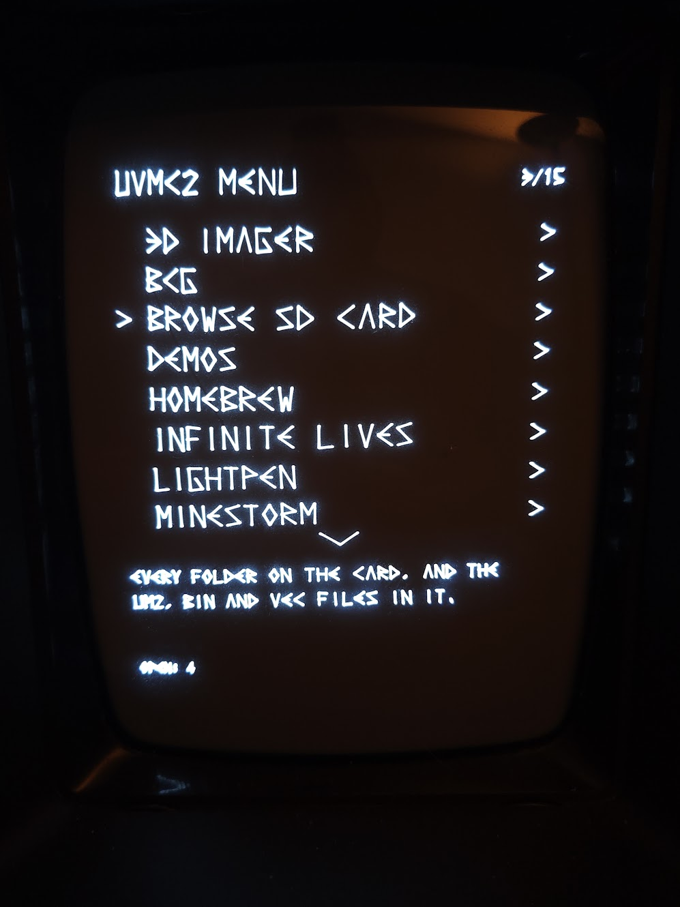
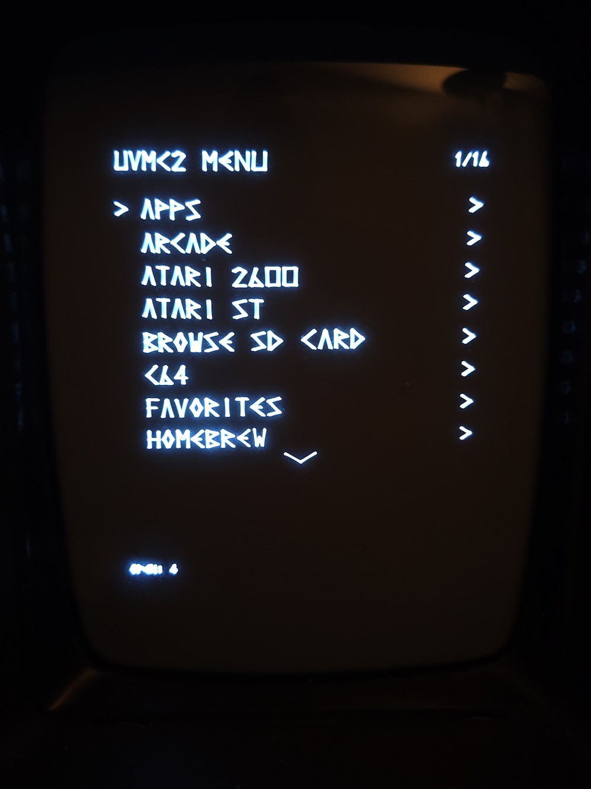

# uvmc2-menu

<table>
<tr>
<td align="center" width="50%"> <em>The default arrangement of the menu system.</em></td>
<td align="center" width="50%"> <em>An example of how you can customize the menu.</em></td>
</tr>
</table>

A custom menu for the **Ultimate Vectrex Multicart 2** (UVMC2), in place of the firmware's own. Nothing is compiled
into it: the games it lists, the folders they are in and the notes under them come from plain-text `.ini` files on the SD card. It also reads the cartridge's built-in
games from the firmware, keeps your favorites, browses the card, and keeps high scores and saves in step with the
firmware.

Version 1.0.0, the first release. Tested on firmware **1.1.13a**. It needs no firmware change: the firmware looks for
`autostart.um2` on the card at power-on and runs it instead of its own menu. The only part of the cartridge's flash the menu
writes is the firmware's own high-score table (32 KB, the same records the firmware keeps); the firmware itself is never
touched, so a bad build cannot brick the cartridge, and renaming `autostart.um2` on a PC puts the stock menu back.

## Demonstration

[Watch the menu in use on YouTube](https://youtu.be/HbULdvkwK8g).

Contents: [Demonstration](#demonstration) · [Install](#install) · [First start on a new card](#first-start-on-a-new-card) · [Using the menu](#using-the-menu) ·
[Making the menu yours](#making-the-menu-yours) · [BROWSE SD CARD](#browse-sd-card) · [SYSTEM](#system) ·
[Built-in games, high scores and saves](#built-in-games-high-scores-and-saves) · [Serving a .bin](#serving-a-bin) ·
[Limits](#limits) · [Build from source](#build-from-source) · [Hardware test](#hardware-test-in-this-order) ·
[Licence and credits](#licence-and-credits)

## Install

You need a UVMC2 on firmware 1.1.13a and an SD card (FAT32 or exFAT) that the cartridge already works with. Put these on
it. From a release archive (`uvmc2-menu-<version>.zip`), copy the contents of its `card/` folder to the card's root; from source,
`make install CARD=...` does the same (see [Build from source](#build-from-source)):

| on the card | what |
|---|---|
| `autostart.um2` | the menu, started by the firmware at power-on |
| `MENU.um2` | the same file, to start from the firmware's BROWSE (it turns the menu back on) |
| `menu/menu.default.ini` | the shipped menu definition |
| `menu/transfer.um2` | SYSTEM / TRANSFER MODE's program; without it that entry is not shown |

Then power-cycle the console, and the menu starts by itself. Nothing else is needed: games and ROM sets already on the card
stay where they are. You can also try it before a power cycle: from the firmware's own menu, BROWSE the card and start
`MENU.um2` (it is an ordinary file in the card's list). The same goes for later changes to your `.ini` files: the menu reads
them each time it starts, so after editing them, start `MENU.um2` from the firmware's menu, or power-cycle, or use SYSTEM /
TRANSFER MODE, after which the menu restarts by itself.

**To undo:** on a PC, rename or delete `autostart.um2`. The firmware's own menu comes back at the next power-on. Or, from
the menu, SYSTEM / TURN THIS MENU OFF (below).

**To update:** copy the new `autostart.um2`, `MENU.um2`, `menu/menu.default.ini` and `menu/transfer.um2` over the old ones.
An update replaces only those files; everything of yours in `menu/` (your `.ini` files, `favorites.ini`, `settings.ini`)
and `config/uvm2.cfg` is never touched.

## First start on a new card

A card with only the files above has no `menu/menu.ini`, no favorites, no calibration. This is what happens:

1. **Title screen**, for 4 seconds or until any button: ARCADE JASON / ULTIMATE / VECTREX / MULTICART 2 and the firmware's
   version (read from the cartridge), with the credits under them: *Firmware, Ralf Kornmann* and *Custom Menu v1.0.0, John
   Emmer*. It shows once per power-on, not each time you come back from a game.
2. **The top level.** The menu lists the cartridge's built-in games, found in the cartridge's flash, in the firmware's own
   categories, and puts the ones the firmware files nowhere in HOMEBREW. On firmware 1.1.13a, a fresh card shows these 15
   entries (the menu draws them in capitals), sorted by title with SYSTEM last:

       3D Imager, BCG, BROWSE SD CARD, Demos, HOMEBREW, Infinite Lives, Lightpen, MineStorm, Music, Original, Spinner,
       Tools, Video, Xmas, SYSTEM

   `menu.default.ini` puts the built-ins the firmware files nowhere into ORIGINAL, TOOLS, MUSIC, XMAS, DEMOS, SPINNER and
   LIGHTPEN folders, and the rest into HOMEBREW. If the menu cannot find the firmware's game list (a different firmware layout) it still works, with
   BROWSE SD CARD and SYSTEM only; SYSTEM / DIAGNOSTICS says what it found.
3. **Your games on the card are not listed.** The menu lists no card game by itself: a freshly formatted card shows the
   built-ins and BROWSE SD CARD, and what goes where is the owner's decision (see
   [Making the menu yours](#making-the-menu-yours)). Until you configure things otherwise, **BROWSE SD CARD** shows you every folder of the card and
   allows you to start any `.um2`, `.bin` or `.vec` file in it.  But you can tell BROWSE to only show files you haven't
   mapped elsewhere with your own configuration.
4. **Calibrate once per console.** Without `config/uvm2.cfg` the menu is drawn with the SDK's defaults and can look
   distorted. SYSTEM / CALIBRATE SCREEN writes that file, which this menu and the SDK-based UVMC2 games and programs
   all read.
5. **Files the menu writes, only when you use certain features:** `menu/favorites.ini` (the first favorite you mark),
   `menu/hiscores.bin` (DIAGNOSTICS, button 3), `config/uvm2.cfg` (CALIBRATE SCREEN), the header of `autostart.um2` (SYSTEM /
   TURN THIS MENU OFF), and, in a 256 KB game's own `.bin`, the saves the game makes (below). `menu/settings.ini` is never
   created by the menu; it is an optional switch you make yourself.

## Using the menu

| input | where | does |
|---|---|---|
| stick up / down | any list | moves the highlight (it wraps) |
| button 4, or stick right | menu | opens a folder, or starts the highlighted game |
| button 1, or stick left | menu | goes back a folder; at the top level there is nowhere to go |
| button 3 | on a game | adds it to your favorites, or removes it again |
| button 2 | on a game or folder with more to show | opens its notes and controls; button 1, 2 or 4, or the stick left or right, closes them |

The line at the bottom shows the buttons that work for the highlighted entry; `MORE: 2` appears only when button 2 has
more to show. The text under the list is the entry's notes (`text =` lines).

**Coming back from a game.** In a game that uses the SDK's reset handling, two presses of reset return to the menu. In a
game of the cartridge's `.bin` type, holding reset for 2 seconds does. A game that does neither may not come back to the
menu without a power cycle.

**Favorites.** A favorite stays where it is and also shows in the top-level FAVORITES folder; the menu draws a mark by it.
It is saved at once in `menu/favorites.ini`, in the menu's own format, one section per favorite. The file can be edited
by hand; only the `file =` lines are read, and about 250 favorites fit:

    [VECTOR KONG]
    file = dkong.um2
    also = FAVORITES

    [RIP OFF]
    file = @fw/Rip Off
    also = FAVORITES

## Making the menu yours

Everything is in `.ini` files in the card's `menu/` folder: sections in `[BRACKETS]`, `key =
value` lines, and `;` or `#` at the start of a line for a comment (` ;` after a value also starts one). Names, paths and
extensions do not care about case, and punctuation in a name is ignored when a name is matched.

### Which files are read, and in what order

1. `menu/menu.default.ini`: the shipped menu. **Do not edit it**; an update replaces it.
2. every other `menu/*.ini`, alphabetically (up to 32 files, each up to about 32 KB). `catalog.ini`, written by `make
   card-ini`, is one of these. An update never touches them.
3. `menu/menu.ini`: **your changes, read last, so they win.**

`menu/favorites.ini` and `menu/settings.ini` are never read as menu files. A later section with the same section name,
file or folder changes the earlier one: what it sets replaces what was there and the rest stays. So `menu.ini` only has
to say what *differs* from the default.

### Nothing on the card is listed until you say so

The default menu lists no card games. There are three ways to put one in, and `examples/menu.ini` has each one to copy
from (it is one person's layout, trimmed, not a default; it does nothing unless you copy from it):

1. **A folder rule** lists the files of one card folder in one menu folder: `folder` is the card folder (`.` is the card's
   root), `files` says which files, by their extensions, and `category` is the menu folder they go in. It does not look in
   subfolders. Every file it lists is started by its own path.

       [CARD FILES]
       category = HOMEBREW
       folder   = .
       files    = um2 bin vec
2. **A file section** (`file = path`) changes how a file that a rule found is shown: its folder (`category`, `also`), its title,
   its notes (`text`), or `hide = 1`. It lists nothing by itself, so the file needs a rule behind it.
3. **An entry** (`image = path`) lists one file from any folder, with no rule. `needs = path` hides it unless that file (a ROM
   set, say) is there too. An entry whose `image` or `needs` file is missing is hidden.

Paths start at the root of the card. If you give the same `.ini` files to someone whose card lacks some of the files, the
entries for the missing files are simply left out.

### Every key

| key | in | meaning |
|---|---|---|
| `[NAME]` | all | the section's name; it is the title shown, unless `title =` says otherwise (up to 31 characters) |
| `image = path` | entry | what to start: a card path, or one of the actions below. A folder rule needs none (each file starts by its own path); if you do give one, `{dir}` and `{file}` stand for the folder and the file's name |
| `file = path` | file section | the file a section describes. `@fw/<name>` is a built-in game, named as the firmware lists it |
| `folder = path` | folder rule | the card folder to list (`.` is the root); `@fw` is the built-in games the firmware puts in no folder |
| `files = um2 bin vec` | folder rule | the extensions to list. This line is what makes a section a folder rule |
| `category = A / B` | any | the menu folder it is listed in; `A / B` is folder B inside A; `/` alone is the top level |
| `also = A, B` | any | lists a second copy in further folders (`FAVORITES` is the favorites folder) |
| `needs = path` | entry | a file that must exist, or the entry is hidden |
| `title = TEXT` | any | the name shown, in place of the section's |
| `text = LINE` | any | a note line shown under the list (up to 12 lines of 47 characters); button 2 shows all of them |
| `control = LINE` | any | a control line, shown with the notes when button 2 is pressed (up to 12 lines) |
| `hide = 1` | any | leaves it out of the menu; it still shows in BROWSE SD CARD. `hide = 0` shows what an earlier file hid |
| `order = listed` | category | keeps the order its entries were written in, instead of sorting by title |

The actions for `image =`: `@browse` is BROWSE SD CARD, `@stock` switches to the cartridge's own menu, `@fwinfo` is
DIAGNOSTICS, `@calibrate` is CALIBRATE SCREEN, and `@fw` (in a folder rule for `@fw`) lists the built-ins.

A section with only a name and changes, and no `image`, `file` or `folder`, changes the earlier section of that name, or if
there is none it describes a category of that name (so `[ARCADE]` with `order = listed` or `hide = 1`).

Sorting: at the top level folders and entries go together by title, with SYSTEM last. Inside a folder, folders come first,
then entries by title, unless the folder says `order = listed`. A folder with nothing left in it is not shown.

### Recipes

**Say where card files go**, as in 1 above. Add one rule per folder you want listed. A new `.bin` dropped into a folder
a rule covers shows up by itself.

**Move, rename or annotate a game** a rule found, or a built-in:

    [VECTOR KONG]
    file     = dkong.um2
    category = ARCADE
    text     = ARCADE: NINTENDO 1981 (DONKEY KONG)

    [RIP OFF]
    file     = @fw/Rip Off
    category = ORIGINAL

**Hide** a file, a built-in, or a whole folder of built-ins:

    [HIDE ZSB]
    file = ZSB.bin
    hide = 1

    [VECTORCLOCK]
    file = @fw/VectorClock
    hide = 1

    [LIGHTPEN]          ; the section name is the folder's name
    hide = 1

**Say where the unfiled built-ins go** (the default is HOMEBREW):

    [BUILT-IN]
    folder   = @fw
    image    = @fw
    category = MY BUILT-INS

**Bring back an ALL GAMES folder** that lists everything:

    [BUILT-IN]
    folder   = @fw
    image    = @fw
    also     = ALL GAMES

    [CARD FILES]
    category = ALL GAMES
    folder   = .
    files    = um2 bin vec

    [PORTS]
    category = ALL GAMES
    folder   = PORTS/UM2
    files    = um2

**Fill in names and developers from the firmware's catalogue.** `python3 tools/gen_card_ini.py <card> > <card>/menu/catalog.ini`
(Python 3 only; `make card-ini CARD=...` does the same) writes `menu/catalog.ini` for the `.bin` and `.vec` files in the card's root, matched by CRC-32 then by name: a matched game appears in its firmware
categories with its developer under the list, and the rest in HOMEBREW. Put your own changes in `menu.ini`.

**Notes for a game you made**, as `examples/e-srg.ini` does: a `file =` section with `text =` lines, in a file of its own
in `menu/`.

### Finding what is not mapped

Open BROWSE SD CARD and press button 2: the list shows only the **unmapped** files, and 2 again brings back all of them. A
file is *mapped* if an entry names it, a hiding section hides it, or a folder rule covers it. So a new `.bin` dropped in a
folder a rule covers is mapped already (it shows in that rule's folder), and a file in a folder no rule covers, or one whose
extension the rule leaves out, is not. A hidden file is mapped: hiding it was a decision about it. A favorite is a mark,
not a mapping. In the unmapped view, open a file with 4 to try it, then add a rule or entry for it.

### Turning the menu off and on

SYSTEM / TURN THIS MENU OFF restarts in the cartridge's own menu, which then comes up at every power-on (the menu sets a flag in
the header of `autostart.um2`). To turn this menu back on, start `MENU.um2` from that menu's BROWSE.

From a PC you can do it with a file you make: `menu/settings.ini` containing `menu = off` switches the menu off at the next
power-on. Starting `MENU.um2` from BROWSE then changes that line to `menu = on`, leaving the rest of the file as it was.

## BROWSE SD CARD

At the top of the menu. It walks the card's own folders: each shows its subfolders and the `.um2`, `.bin` and `.vec`
files in it (any case); other files are left out. Stick up and down moves, 4 or right opens a folder or starts a file, and
1 or left goes back up, then out to the menu at the root.

- The heading is the whole path; when it is too long its start is cut and shown as `...`, so the folders you are in
  stay visible.
- The highlighted entry's whole name shows under the list, for names too long for it.
- A line below says what the folder holds that the list leaves out, so a folder that looks short or empty explains itself:
  `12 FILES NOT SHOWN: ONLY UM2 BIN VEC` counts the files of other kinds (a config file, a ROM set), and in the unmapped view
  `n MAPPED FILES NOT SHOWN` counts the ones the filter left out. Names that start with `.` and hidden or system files
  never reach the menu (the SDK's folder listing skips them), so they are not counted.
- A folder lists up to 1024 entries; past that it shows `SHOWING 1024 OF n: USE SUBFOLDERS`.
- Button 3 on a file marks it as a favorite, or unmarks it; it then shows in FAVORITES even if nothing else lists it.
- Button 2 switches between all files and only the unmapped ones (above). It starts on all files each time BROWSE is
  opened, and the hint row says which view you are in.

Apart from `menu/favorites.ini`, the browser only reads the card and never changes or deletes a game.

## SYSTEM

| entry | does |
|---|---|
| CALIBRATE SCREEN | the SDK's calibration screen, the same one `uvmc2_calibration.um2` shows and that opens when buttons 2 and 3 are held while a `.um2` starts. It saves `config/uvm2.cfg`. It opens once the stick and buttons are let go, because it measures the stick's centre as it starts |
| DIAGNOSTICS | what the menu found and how it runs; the page to report when something goes wrong (below) |
| TRANSFER MODE | the SD card as a USB drive (below) |
| TURN THIS MENU OFF | restarts in the cartridge's own menu (above) |

**TRANSFER MODE** works like the firmware's System / Transfer Mode: connect the cartridge's USB to a computer and the card
appears there (USB id `cafe:4003`, the firmware's, named UVMC2 MENU; a serial port too, as the firmware offers, unused).
Eject it on the computer, or press RESET on the console, and the cartridge restarts into this menu, which reads the card
afresh. It is a program of its own, `menu/transfer.um2` (`transfer/`, built by `transfer.mk`), so that the menu keeps its RAM:
TinyUSB and its buffers would need about 17 KB the menu does not have. The card's size comes from its partition table
(`src/sdsize.c`), because the SDK's SD driver cannot ask the card. Sectors move in runs with the card's multi-block commands
at 25 MHz (`transfer/sdfast.c`); the SDK's one-sector path stays as a fallback. Measured on a test card, 4 MB: written in
6.5 s and read in 6.3 s, against 5.6 s and 5.4 s through the firmware's Transfer Mode. Connecting reads about 9 MB on a 64
GB card: the computer scans the whole FAT to count free space. The small lines on its screen are there to be reported when
something goes wrong:

| line | meaning |
|---|---|
| `FAST, FALLBACKS n` | runs of sectors go through `sdfast.c`; n requests had to use the SDK's slower path (expected 0). `SLOW PATH`: the 25 MHz check at start failed, everything uses the SDK's driver |
| `R ms n  W ms n` | time spent in the card reading and writing, and the USB requests that took it |
| `SCREEN ms n` | time spent redrawing this screen, and how often (once a second while the figures change) |

**DIAGNOSTICS** shows what the menu found in flash (`GAMES n`) and how long that took. `MENU BUILD n MS` is how long it took
to read the ini files and build the tree. `SECTIONS n / 1024` is how many ini sections it holds, against the limit; more
than that shows MENU TOO LONG. `HIGH SCORES n / 2048` is how many records the firmware's score table holds; button 3 on that
page saves the whole table to `menu/hiscores.bin`, and `tools/hs_dump.py menu/hiscores.bin --card <card root>` says which
game each record is for and whether it is a score (built-ins by the firmware's list, card `.bin` / `.vec` files by their
CRC). `tools/scan_firmware.py` is the same scan of the firmware for a PC, and `make test-fw FW="..."` checks scan and unpack
against firmware images.

## Built-in games, high scores and saves

At boot the menu looks through flash for the firmware's game list by its shape (`src/fwcat.c`), so a firmware update needs
no rebuild as long as the list keeps its layout. Games of 32 KB or less, the 64 KB one and the two 192 KB ones (Telengard,
VectorbladeV1.13) are listed in their firmware category (Original, Music, Tools and so on, or HOMEBREW when the firmware
files them nowhere), with the developer under the list.

**High scores** live in the firmware's own table in the cartridge's flash, so a score set from either menu shows in both.
For a built-in game or a card game of up to 32 KB, the menu writes the saved score into the console before the game starts,
and while it runs the cartridge watches the console's writes to the BIOS's score slot (`$CBEB`) and saves a new score once it
has settled (and before the reset-hold reboot). This covers a 64 KB card game and the 64 KB and 192 KB built-ins too (keyed as
the firmware keys them: the CRC of the 64 KB image as it re-orders it, or the CRC in its game list). The firmware keeps no
score for a 256 KB or a streamed game, so neither does this menu. The firmware also writes an empty record for every game it
starts, so the table holds more records than games you have a score in; `tools/hs_dump.py` labels each one.

**Saves.** A 256 KB game can program its flash chip, and the menu keeps what it writes, as the firmware does: about every
100 ms it writes each changed 4 KB page back into the game's own `.bin` on the card (so that file stops being a pristine
copy: keep a backup if you want one). Telengard's characters work this way, and load from either menu. A built-in flash
game's save, which the firmware keeps in its own flash, is not kept by this menu.

## Serving a .bin

`src/cartserve.c` does what the firmware's server loop does: core 1 watches the bus and answers reads below $8000 from
memory. To start the game without a reset, it writes `JMP $F000` to the BIOS's NMI vector in console RAM while the 6809 is
still halted, pulls /NMI low, starts answering, then releases /HALT. If the screen stays black, one press of the console's
reset starts the game too. Holding reset for 2 seconds returns to the menu.

Over 32 KB, `src/cart.c` decides by size alone, as the firmware does (`docs/bankswitch.md`): 64 KB is two 32 KB banks chosen
by PB6; 256 KB is four banks of 48 KB, seen at $0000-$BFFF, chosen by PB6 and the pin next to it (GPIO23, which the SDK calls
/IRQ), with an SST39SF020-style flash that takes the program and identity commands. `src/cartload.c` reads the file into 16 KB
slots in the order the server expects, over the menu's own memory (its ini records and tree, kept at least 208 KB for this).
With the menu gone, an SD card error halfway restarts the cartridge instead of showing a message. The banks follow the live
pins, so if a 256 KB game misbehaves, suspect first the bank line the console does not drive.

## How the menu starts a game

| | |
|---|---|
| Starting a `.um2` | Reads the file to PSRAM, stops core 1, DMA and PIO, then a stub in scratch memory copies it to SRAM, leaves the path at `0x20080000`, sets watchdog scratch 0 to `2CMU` and calls `rom_reboot(RAM_IMAGE)`, as the firmware does at `0x10f56040`. |
| Coming back | SDK games reboot normally on a double reset, and the firmware runs autostart again. |
| Switching off | Sets the top bit of the block count in `autostart.um2`'s header, in place (only those 12 bytes, through FatFs; the SDK's `uvm2_sd_overwrite` would rewrite the whole first sector and end it with a newline). The firmware refuses counts above 20 and falls through to its own menu. Clearing the bit turns it back on. |
| Title screen | Once per power-on (marked in watchdog scratch 1): the firmware's lines (read from the cartridge header by `fw_title`; a fixed credit if it cannot be found) for 4 seconds or until a button, moved up 12 units, and under them in small type the credits. The menu version is the `VERSION` file, which the Makefile passes to the build. |

## Limits

- `.bin` and `.vec` of up to 32 KB, exactly 64 KB (PB6), exactly 256 KB (flash) and over 256 KB (streamed: the firmware's
  videos and files like `TankPotrace310.bin`) are served: the sizes the firmware serves. Other sizes show a reason; 128 KB is
  refused by the firmware too. Streaming needs the firmware's video player (VIDE's ExtremePlayer), which the menu finds in
  flash; without it a video shows NO VIDEO PLAYER IN FIRMWARE. Streaming has not yet been run on a console.
- The menu holds up to 1500 entries and 40 KB of titles and paths; a game listed in two places is two entries but one set of
  names. More than that shows MENU TOO LONG. DIAGNOSTICS shows how much is used.
- Up to 1024 ini sections, 32 `.ini` files besides the default and `menu.ini`, and about 32 KB per file. Beyond that shows
  MENU TOO LONG, or the rest of a file is ignored.
- Up to 256 built-in games. A firmware with more shows SOME BUILT-IN GAMES NOT LISTED.
- About 250 favorites: the menu keeps their paths in 8 KB of memory, and the file may be up to 16 KB; the menu says FAVORITES FILE TOO BIG when it is full.
- A built-in flash game's save is not kept, and a game that does not use the SDK's reset handling may not come back to this
  menu.
- The SD bridge in `uvmc2.py` needs the stock menu, because this menu has no USB monitor. The SDK's debug monitor could be
  built in for live debugging: see `docs/usb-debug-monitor.md`. SYSTEM / TRANSFER MODE copies files over USB instead.
- Firmware behaviour was read from a disassembly of 1.1.13a only; the scan and unpack are tested on 1.1.9a to 1.1.13a.
- With USB connected the cartridge keeps running when the console is switched off; unplug USB to test a power cycle.

## Build from source

### Dependencies

Fetched for you, pinned in this repo:

| what | version | where it comes from |
|---|---|---|
| UVMC2 SDK (drawing, input, SD card, bus, `.um2` packaging) | v1.4.7 | submodule `third_party/uvmc2-sdk`, from [tullulah/uvmc2-sdk](https://github.com/tullulah/uvmc2-sdk) |
| pico-sdk (RP2350 start-up, hardware, boot ROM, CMake build) | 2.2.0 | submodule `third_party/pico-sdk`, from [raspberrypi/pico-sdk](https://github.com/raspberrypi/pico-sdk) |
| picotool (the pico-sdk's image tool) | the pico-sdk's | downloaded and built by the pico-sdk's CMake on the first `make uvm2`, into `build_uvm2/pico/_deps` |
| TinyUSB (`transfer.um2` only) | the pico-sdk's | fetched into the pico-sdk by `make transfer` |
| Rust compiler and its Arm target | 1.91.1, `thumbv8m.main-none-eabi` | installed by rustup on first use, from the UVMC2 SDK's `rust-toolchain.toml` |

A plain `git clone` is enough: the first `make` fetches both submodules at the pinned commits (or run
`git submodule update --init`). Not `--recurse-submodules` or `--recursive`: those also fetch the pico-sdk's own submodules
(WiFi, Bluetooth, lwIP, mbedTLS), which are not needed. The first build needs the network for the submodules, picotool, TinyUSB
and Rust. `make uvm2` prints the two SDK versions and stops on any other pico-sdk.

Install these yourself:

| what | version used | where to get it | for |
|---|---|---|---|
| Arm GNU Toolchain, `arm-none-eabi` | 15.2.Rel1 | [developer.arm.com](https://developer.arm.com/downloads/-/arm-gnu-toolchain-downloads), "AArch32 bare-metal target"; the UVMC2 SDK wants Arm's build, not a distribution's `arm-none-eabi-gcc` | `make uvm2` |
| rustup (Rust's installer) | 1.29 | [rustup.rs](https://rustup.rs) | `make uvm2` |
| CMake | 4.4 (3.13 or newer) | your system's packages, or [cmake.org](https://cmake.org/download/) | `make uvm2` |
| GNU make, git, a host C and C++ compiler | make 4.4, git 2.56, gcc 16 | your system's packages | everything; C++ builds picotool |
| Python 3 | 3.14 | your system's packages | `make card-ini`, the tools |
| zlib (development files) | | your system's packages | `make test` (the host tests link `-lz`) |
| Python packages `unicorn`, `pyelftools` | | `pip install unicorn pyelftools` (a venv is fine: `make stub-check PY=venv/bin/python`) | `make stub-check` only |
| Python package `Pillow` | | `pip install Pillow` | `tools/font_*.py` only |

`make` finds these on the PATH. If they are installed somewhere else, copy `local.mk.example` to `local.mk` (not committed) and
set the paths there; `make` reads it by itself, so nothing needs sourcing first. `make uvm2` stops with the tool's name if one
is missing. Licences of all of the above are in `THIRD_PARTY_NOTICES.md`.

### Commands

    git submodule update --init
    make test               # host tests
    make uvm2               # build_uvm2/uvmc2menu.um2
    make transfer           # build_transfer/transfer.um2 (TRANSFER MODE's program)
    make dist               # dist/uvmc2-menu-<VERSION>.zip: card/ files plus README, licence, notices, examples, tools
    make install CARD=/run/media/$USER/UVMC2          # autostart.um2, MENU.um2, menu/menu.default.ini, menu/transfer.um2
    make install-test CARD=...                        # MENU.um2 only, started from BROWSE; boot does not change
    make card-ini CARD=...                            # menu/catalog.ini for the games in the card's root
    make preview CARD=... INIS="..."                  # prints the menu it would build from a card, read only (needs a C compiler)
    #   add FLASH=flash.bin to include the built-ins from a firmware image
    make stub-check PY=...  # runs the launch stub in an emulator
    make test-fw FW="a/flash.bin b/flash.bin"         # scan and unpack against firmware images

`make install` is a copy: of `menu/` it replaces `menu.default.ini` and `transfer.um2` and nothing else.

### Hardware test, in this order

**Step 1, boot unchanged:** `make install-test CARD=...`, then start `MENU.um2` from the firmware's Browse SD card.

1. The list appears. Stick up and down moves, 4 or right opens or starts, 1 or left goes back.
2. Text fits the screen and is readable. TURN THIS MENU OFF shows its text under the list. The line at the bottom says what
   the buttons do; MORE appears only when Button 2 has more to show.
3. Start a small game, then a big one (`vectorblade-sj`), then one that reads its own data (`PORTS/UM2/demonattack`,
   `OUTRUN`, `aae_tacscan`). Each must behave as it does from Browse.
4. Press reset twice in a game: from this step you land in the **stock** menu.

**Step 2, replaces the stock menu:** `make install CARD=...`, power-cycle.

5. The custom menu appears by itself.
6. Start a game, press reset twice: back to the custom menu.
7. SYSTEM / TURN THIS MENU OFF: the stock menu appears, and stays after a power cycle.
8. Start `MENU.um2` from Browse: it shows MENU IS ON AGAIN. Power-cycle: the custom menu again.
9. Create `menu/settings.ini` containing `menu = off`, power-cycle: the stock menu appears. Start `MENU.um2` from Browse: MENU IS
   ON AGAIN, and `settings.ini` now says `menu = on` (the rest of the file as it was).

**To undo at any point:** on a PC, rename or delete `autostart.um2`.

## Files in this repository

| path | what |
|---|---|
| `src/` | the menu (`main.c` is the device program; the rest is host-testable) |
| `src/pitrex/` | the ini parser (the folder keeps the name of the project it was first written for) |
| `transfer/`, `transfer.mk` | TRANSFER MODE's program |
| `card/menu/menu.default.ini` | the shipped menu definition |
| `examples/` | `menu.ini`, one card's layout to copy from; `e-srg.ini`, notes for one game |
| `tests/` | host tests (`make test`) and the launch-stub emulation |
| `tools/` | `hs_dump.py`, `scan_firmware.py`, `gen_card_ini.py`, `gen_catalog.py`, the font tools, `preview.c` |
| `data/firmware-catalog-1.1.13a.json` | the built-in games' names, CRCs, developers and categories, read from the firmware |
| `docs/bankswitch.md` | how the firmware serves images over 32 KB, from its disassembly |
| `docs/usb-debug-monitor.md` | notes on the SDK's debug monitor |
| `third_party/` | the UVMC2 SDK and pico-sdk, as submodules; never edited |
| `VERSION` | the release number: the one place it is set (the title screen, the archive name and the changelog check read it) |
| `scripts/run-task.sh`, `docs/superpowers/plans/` | the helper and plans used when coding agents did parts of the work |
| `CHANGELOG.md`, `LICENSE`, `THIRD_PARTY_NOTICES.md` | what changed, the licence, and what this builds on |
| `AGENTS.md` | notes for coding agents working on the code |

The font is this project's own, drawn with as few strokes as possible: `src/font_data.h`; `tools/font_preview.py` draws a
sheet of it.

## Licence and credits

This project is under the **GNU General Public License, version 3** (`LICENSE`). Copyright 2026 John Emmer.

It is built on Ralf Kornmann's UVMC2 firmware (not included: the menu reads what it needs from the cartridge), on Dani Ferrer's
([tullulah](https://github.com/tullulah)) UVMC2 SDK, used as a submodule, and on FatFs (ChaN), the Raspberry Pi pico-sdk and
TinyUSB. `THIRD_PARTY_NOTICES.md` lists each with its licence, including
that the SDK has no licence file yet and its author intends MIT. No game, BIOS or ROM is distributed.
